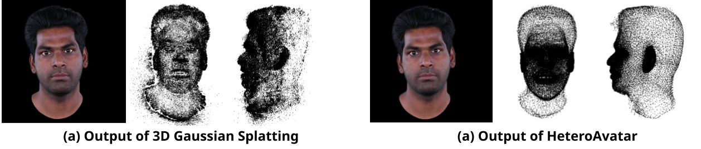

<div align="center">

# HeteroAvatar: <br> Generation of Gaussian Head Avatars With Correct Geometry Using Hetero Rendering

[**Ahmet Cagatay Seker**](https://acseker.github.io/acseker/)<sup>1,2,&dagger;</sup>&nbsp;·&nbsp;
[**Jun Seok Kang**]()<sup>1,2,&dagger;</sup>&nbsp;·&nbsp;
[**Sang Chul Ahn**](https://sites.google.com/view/asckist)<sup>1,2,&#9993;</sup>

<sup>1</sup> [University of Science and Technology](https://www.ust.ac.kr/eng/) &nbsp;·&nbsp;
<sup>2</sup> [Korea Institute of Science and Technology](https://www.kist.re.kr/eng/index.do)

<sup>&dagger;</sup> Denotes equal contribution &emsp;
<sup>&#9993;</sup> Corresponding Author &emsp;

[](https://doi.org/10.1109/ACCESS.2025.3543163)
[](https://felizang.github.io/HeteroAvatar/)

</div>


## Overview
<div align="center" style="margin-top: 0px;">
  
</div>
<p align="justify">
    Given a monocular video of a dynamic head, the head avatars generated through
    <b>(a)</b> 3D Gaussian splatting only and <b>(b)</b> <b>HeteroAvatar</b>,
    which utilizes 3D Gaussian splatting with mesh rendering concurrently, produce notably distinct outcomes.
    <b>From left to right:</b> a rendered image using 3D Gaussian splatting,
    followed by frontal and side views of the 3D Gaussian position visualizations.
    The method of 3D Gaussian splatting alone results in a head avatar composed of numerous Gaussians
    that fail to conform precisely to the head's geometry. In contrast, HeteroAvatar generates a head geometry
    with fewer 3D Gaussians that more effectively align with the actual geometric structure.
</p>


## Citation
If you find this work useful in your research, please consider citing:
```bibtex
@article{seker2025heteroavatar,
  title     = {HeteroAvatar: Generation of Gaussian Head Avatars With Correct Geometry Using Hetero Rendering},
  author    = {Seker, Ahmet Cagatay and Kang, Jun Seok and Ahn, Sang Chul},
  journal   = {IEEE Access},
  volume    = {13},
  pages     = {33768--33782},
  year      = {2025},
  publisher = {IEEE}
}
```


